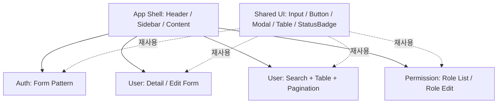

# 화면 구조 및 기능별 개발 인계 (AA Draft)

화면 IA/주소·UI ID 정본은 [Contract 화면 구조](https://github.com/00700lsm/user-management-contract/blob/dev/docs/ui-structure.md), 실제 Request/Response는 [OpenAPI](https://github.com/00700lsm/user-management-contract/blob/dev/openapi.yaml)를 참고합니다.

| 담당 | UI ID | 경로 | 화면·주요 동작 | 계약 API |
|---|---|---|---|---|
| A | UI-AUTH-001 | /login | 로그인 ID/비밀번호 입력, 제출, 실패 안내, 성공 이동; 로그아웃 동작 제공 | POST /auth/login, POST /auth/logout |
| A | UI-AUTH-002 | /settings/password | 이전·신규 비밀번호, 확인 검증, 변경 완료/실패 | POST /auth/password/change |
| B | UI-USER-001 | /signup | ID·이름·이메일·비밀번호, 필수값 및 중복 오류, 완료 | POST /users/signup |
| B | UI-USER-002 | /me | 본인 이름/이메일 확인·수정, 저장 성공/오류 표시 | GET/PATCH /users/me |
| B | UI-USER-003 | /admin/users | 검색(이름/이메일), 상태 필터, 0-based 페이지/크기, 표·등록/상세 이동 | GET/POST /admin/users |
| B | UI-USER-004 | /admin/users/:id | 상세 조회, 정보 수정, 상태 변경, 권한 관리 화면 이동 | GET/PATCH /admin/users/{id}, PATCH /admin/users/{id}/status |
| C | UI-PERM-001 | /admin/roles | 사용 가능한 Role 목록 조회 | GET /admin/roles |
| C | UI-PERM-002 | /admin/users/:id/roles | 사용자 역할 조회·선택·저장 | GET/PUT /admin/users/{id}/roles |

경로는 UI Route이며, API의 실제 서버 접두사는 OpenAPI `servers.url=/api`를 따릅니다.

## 공통 Shell / 화면 패턴

- App Shell은 인증 상태/권한에 따라 메뉴 및 접근을 제한하되 Backend의 권한 검사를 대체하지 않습니다.
- 관리자 화면은 ADMIN 전용; 비인가 시 안내 상태를 처리합니다.
- UI는 Empty/Loading/Error/Success/Forbidden, 입력 검증과 키보드 접근을 지원합니다.
- 사용자 목록에서 **Role 표시**가 필요하면 현재 User 응답에 포함되어 있지 않습니다. Permission API 추가 호출·계약 개정 중 어느 쪽인지 [DEC-008](https://github.com/00700lsm/user-management-contract/blob/dev/docs/aa/decisions.md)에서 결정해야 합니다.
- 관리자의 사용자 생성 초기 비밀번호 UX는 [DEC-006](https://github.com/00700lsm/user-management-contract/blob/dev/docs/aa/decisions.md) 결정 전 임의 확정 금지.

## 구현자에게 맡기는 부분
구체 UI 라이브러리·스타일 토큰·반응형 Breakpoint·컴포넌트 API 내부 구조는 Frontend Lead/개발자 설계와 합의를 거칩니다. AA 초안은 픽셀 단위 디자인 시안이 아닙니다.
