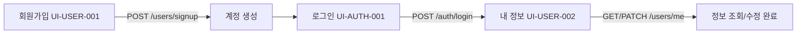
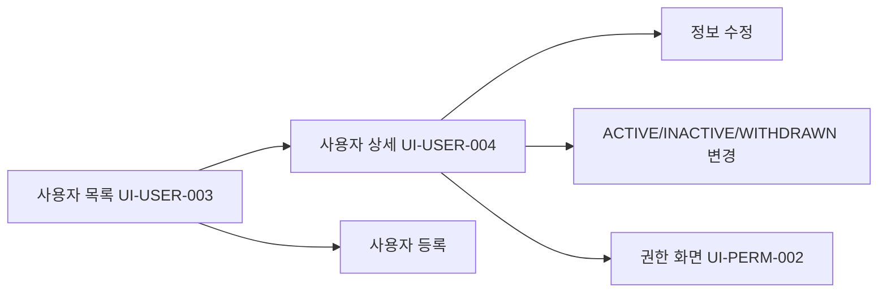
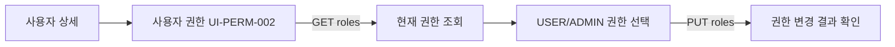

# 주요 사용자 흐름 및 통합 테스트 시나리오 (AA Draft)

## 1. 일반 사용자 가입/로그인/내 정보

- Guest는 가입/로그인 가능. 로그인된 USER는 내 정보 조회·수정 가능.
- 중복 아이디/이메일, 로그인 실패, 미인증 접근 등 비정상 흐름을 포함합니다.
- 가입 과정의 User↔Auth↔Permission 처리/실패 복구 방식은 아직 결정되지 않았습니다.

## 2. 관리자 사용자 관리

- 목록에서 이름/이메일 검색, 상태 필터, 페이지 이동을 검증합니다.
- ADMIN 외 접근 제한, 없는 사용자 404, 상태변경 성공/실패 UX를 확인합니다.
- 등록 시 초기 암호 배포 정책은 결정 전까지 차단 항목입니다.

## 3. 관리자 Role/Permission

- Role 목록은 UI-PERM-001에서 조회합니다.
- 권한 없는 사용자의 접근 차단, 중복 입력, 변경 완료와 재조회 일치 여부 검증이 필요합니다.

## 구현 시 연계 지점
- User 상세에서 Permission 화면으로 사용자 식별자를 전달합니다.
- Auth 인증 상태 및 ADMIN 권한 정보를 공통 Shell과 각 화면에서 사용합니다. 토큰 저장·만료·갱신은 [DEC-001](https://github.com/00700lsm/user-management-contract/blob/dev/docs/aa/decisions.md) 이후 구체화합니다.
- 모든 요청/응답 필드는 `contract.sha`의 OpenAPI로 생성된 타입을 사용합니다.
- 주요 흐름의 E2E 구현 여부는 별도 테스트 증거로 기록해야 합니다. 도식화했다고 실행 완료는 아닙니다.
